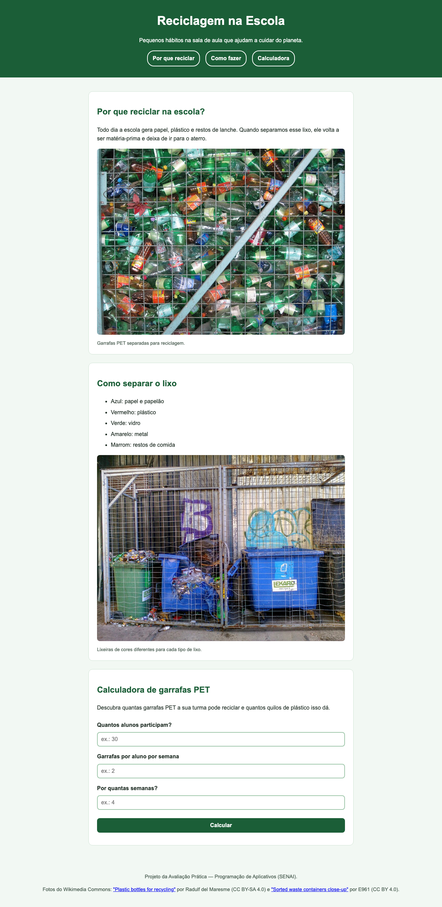
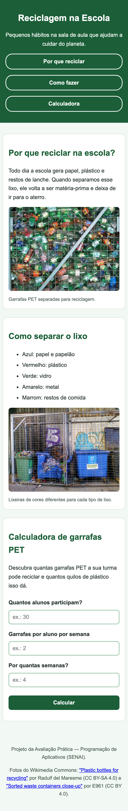
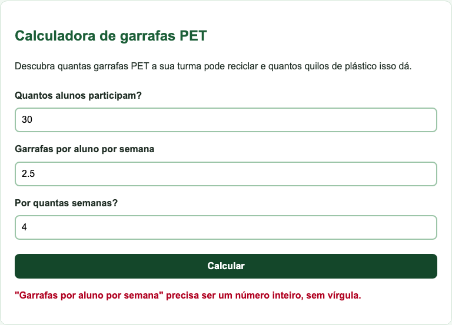
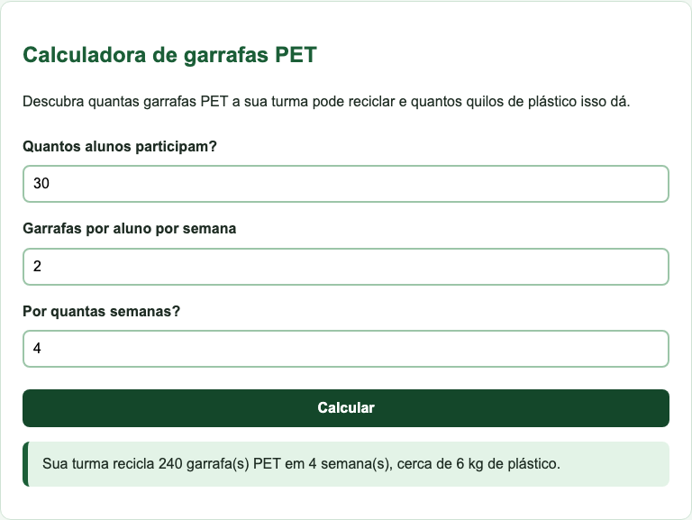

# Evidências da avaliação

## E1 — Repositório público

https://github.com/theopadilha2009-hash/pagina-tema-livre

## E2 — Página inteira no computador (1280 px)

## E3 — Página em largura de celular (375 px)

## E4 — Formulário recusando e aceitando

**Envio inválido** (garrafas por aluno = 2.5, número decimal):

**Envio válido** (30 alunos, 2 garrafas, 4 semanas):

## Testes feitos com o formulário

Testados no Chromium, preenchendo os campos e clicando em **Calcular**. Depois de cada envio recusado, a página continuou funcionando: o campo foi corrigido e o envio seguinte funcionou, sem recarregar.

| # | Alunos | Garrafas | Semanas | Esperado | Resultado na página |
|---|--------|----------|---------|----------|---------------------|
| 1 | (vazio) | (vazio) | (vazio) | Recusa | Preencha o campo "Quantos alunos participam?". |
| 2 | espaços | 2 | 4 | Recusa | Preencha o campo "Quantos alunos participam?". |
| 3 | letras (`abc`) | 2 | 4 | Recusa | O navegador não aceita letras; o campo fica vazio e cai na recusa do teste 1. |
| 4 | 30 | 2.5 | 4 | Recusa | "Garrafas por aluno por semana" precisa ser um número inteiro, sem vírgula. |
| 5 | -5 | 2 | 4 | Recusa | "Quantos alunos participam?" precisa estar entre 1 e 1000. |
| 6 | 0 | 2 | 4 | Recusa | "Quantos alunos participam?" precisa estar entre 1 e 1000. |
| 7 | 5000 | 2 | 4 | Recusa | "Quantos alunos participam?" precisa estar entre 1 e 1000. |
| 8 | 30 | 2 | 4 | 240 garrafas, 6 kg | Sua turma recicla 240 garrafa(s) PET em 4 semana(s), cerca de 6 kg de plástico. |
| 9 | 1 | 1 | 1 | 1 garrafa, 0,025 kg | Resultado correto (limite inferior). |
| 10 | 1000 | 50 | 52 | 2.600.000 garrafas, 65.000 kg | Resultado correto (limite superior). |

O console do navegador não mostrou nenhum erro de JavaScript sem tratamento em nenhum dos 10 casos.

Medida de largura: em 375 px e em 1280 px a página não tem rolagem horizontal.
